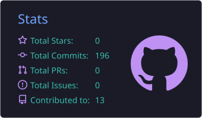
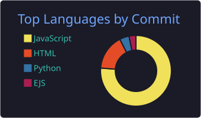

 

---

## 🚀 What I've shipped

<table>
<tr>
<td width="50%" valign="top">

### Faculty Metrics
A faculty-review platform, live across **604 faculty profiles**.

**800+** students reached · **340+** ratings · **15+** REST APIs

Students browse ratings and comments and submit ratings with zero friction: no signup, no password. Posting a comment needs email verification, which keeps comments accountable. A token system blocks duplicate submissions, and admins moderate through a dashboard behind domain-restricted Google OAuth.

`React` `Express` `PostgreSQL` `Supabase` `Vercel`

<!-- TODO: replace the links below with your real URLs, then delete this comment -->
[Live site](https://facultymetrics.vercel.app/faculty) · [Code](https://github.com/Singh1veer/Faculty-Feedback)

</td>
<td width="50%" valign="top">

### Travel Advisor
Multi-criteria route comparison, built with a team of 3.

**Dijkstra's algorithm**, `O((V+E) log V)`, for near real-time shortest-path queries. Designed so new city nodes plug in without rewrites.

`Node.js` `Express` `Bootstrap` `JavaScript`

<!-- TODO: replace the link below with your real URL, then delete this comment -->
[Code](https://github.com/Singh1veer/Travel-Advisor)

</td>
</tr>
</table>

<b>🔍 How Faculty Metrics works (click to expand)</b>

 

- **Zero friction to browse and rate.** Anyone can read ratings and comments and submit a rating with no account. A token-based flow prevents duplicate reviews.
- **Email verification for comments.** Students verify their email before posting a comment, so discussions stay accountable without a full signup.
- **Moderation built in.** Review queue, approve/reject, and suspension controls for admins.
- **Authentication only where it matters.** Email verification guards comments, and admin access uses Google OAuth restricted to the institute domain.
- **Safe data layer.** 15+ REST APIs using parameterized SQL, deployed on Vercel + Supabase.
- **Handoff-ready.** Documented so non-technical admins can run it.

<b>🧠 How Travel Advisor works (click to expand)</b>

 

- Found a real need: comparing routes on more than one criterion.
- Led requirements gathering and the end-to-end design for the team.
- Dijkstra computes the shortest path dynamically, so queries feel instant.
- Responsive Bootstrap UI on a Node.js/Express backend.

---

## 🤖 Machine learning

### UniMail: Email Classification System
An end-to-end NLP pipeline that sorts university emails into **10 categories** (Exams, Placements, Hackathons, Scholarships, Assignments and more), so students don't miss the announcements that matter.

**The pipeline:**

1. **Prepare data:** collect university email subjects and bodies, then manually verify the labels used for training.
2. **Extract features:** combine subject and body, then apply **TF-IDF** with unigrams and bigrams.
3. **Train and compare:** Multinomial Naive Bayes, Logistic Regression, and Linear SVM.
4. **Evaluate properly:** stratified cross-validation, with the best model chosen by **macro F1-score**.
5. **Ship it:** the winning pipeline is saved with Joblib and powers a **Streamlit** dashboard that connects to Gmail (read-only OAuth 2.0), classifies recent emails, lets you browse by category, and exports results to CSV.

`Python` `Pandas` `scikit-learn` `Streamlit` `Gmail API`

[Code](https://github.com/Singh1veer/Email_Classification)

## 🛠️ Tech stack

  
  
  

  
  
  
  

  
  
  
  
  
  

---

## 📊 GitHub stats

  

---

## 🎓 Education and certifications

<b>Open the details</b>

 

- **Thapar Institute of Engineering and Technology**
- Full-Stack Web Development Bootcamp (Udemy)
- HackerRank: Frontend Development (React)
- HackerRank: Problem Solving

---

💬 **Ask me about:** full-stack development, machine learning, building products students use

🤝 **Open to:** collaborations and projects worth building

